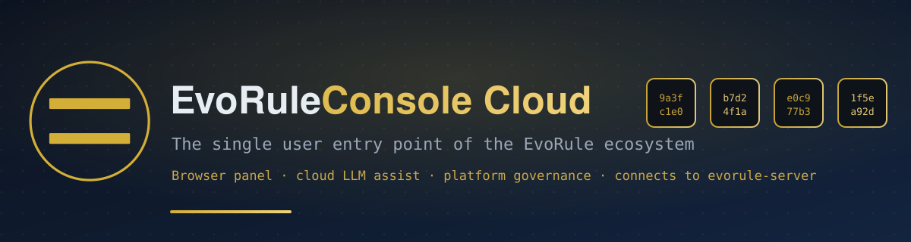

<!-- SPDX-License-Identifier: AGPL-3.0-or-later -->
<!-- Copyright (C) 2026 EvoRule Project -->



<div align="center">

# EvoRule Console Cloud

**evorule rule-engine console · the connected public edition** — a professional starting point for secondary developers (core engine + connectivity + cloud LLM + platform governance)

[![CI][badge-ci]][ci] [![License][badge-license]][license-file]

</div>

---

## ⚡ Try It Online — Zero Install, Zero Backend

**[👉 Launch the WASM Online Demo →](https://evorule.github.io/evorule-console-cloud/)**

No download, no install, no server — the evorule engine itself is compiled to **WebAssembly and runs inside your browser**. Open the URL and start in seconds; after the first visit the app is cached by a **Service Worker** and keeps working **offline**.

**What you get online:** the full evorule engine in-browser (pure-synchronous `execute_transition` + BLAKE3 hash chain verified client-side), all **16 business rules** live (finance 6 + medical 6 + MLPS 4), an interactive **7-step guided tour**, audit-chain verification, and time-travel replay — all with zero network dependency after first load. The demo is built and deployed to GitHub Pages automatically by `.github/workflows/deploy-demo.yml` on every push to `main`. Append `?backend=wasm|http|mock` to the URL to force a backend mode (the online build defaults to `wasm`).

### Two ways to experience evorule

| | **Online (WASM)** | **Local (dev / connected)** |
| --- | --- | --- |
| Engine | evorule compiled to WASM, runs in your browser | Real Rust `evorule-server` |
| Setup | Open the URL — that's it | Clone + `npm run dev`, or connect a running server |
| Business rules | 16 rules live (finance 6 + medical 6 + MLPS 4) | Same 16 rules, editable |
| Guided walkthrough | 7-step interactive tour | 7-step tutorial (`QUICKSTART.md`) |
| Audit chain | BLAKE3 hash-chain, verified in-browser | BLAKE3 hash-chain + WAL persistence |
| Offline use | ✅ Service Worker cache (after first visit) | ✅ Fully offline |
| Rule hot-reload | ❌ rules are read-only in-browser | ✅ edit JSON + `/api/rules/reload` |
| Bundle management | ❌ not available online | ✅ import / activate bundles |
| Persistence | ❌ session resets on refresh | ✅ WAL persistence |

> Just want a quick feel? Stay online. Want to edit rules, hot-reload, manage bundles, or keep state across refreshes? Run the console locally against a real `evorule-server` — see [Run with evorule-server](#run-with-evorule-server-full-capability-mode) below.

---

## Quick Start for New Project Owners

- **[⚡ Online WASM demo (no install)](https://evorule.github.io/evorule-console-cloud/)** — open the URL, walk the 7-step tour, verify the BLAKE3 chain in-browser
- **[5-Minute Quick Start (Developer Path)](./docs/tutorial/01-quickstart.md)** — clone the repo + dev environment, go from 0 to your first running rule
- **[❓ In-browser Help Page](http://127.0.0.1:5174/help)** — the "❓ Help" button at the bottom of the sidebar after the service starts
- **[One-Click Start/Stop Guide](./README-STARTUP.md)** — both desktop double-click and command-line methods

---

## For Decision Makers (30-Second Read)

> evorule is the **compliance & audit layer** for AI Agents — making every decision of an AI Agent auditable, replayable, and rollable-back.

| Pain Point | evorule's Answer |
| --- | --- |
| AI Agent decisions are opaque | BLAKE3 hash-chain — every decision is tamper-evident and traceable |
| Can't locate root cause when something breaks | Time-travel replay + causal-chain analysis, locate in seconds |
| Compliance audits are hard to pass | Audit export satisfies EU AI Act Article 12 + China MLPS 2.0 Level 3 |
| Rule publishing has no controls | Three-tier permission approval + rolling session hot-reload with zero downtime |

evorule-console-cloud is the **single project-owner entry point of the ecosystem**: every project-owner operation — rule library, execution, audit, replay, approval — converges in this browser console. For the full repository map, see the [evorule organization](https://github.com/evorule).

### 4 Guided Tasks (experience the full chain in 2–3 minutes)

1. **Add a rule** (2 min): add a hospital rule "patients over 65 with fever must get a CT first"
2. **Find a problem** (1 min): locate why patient P-1283 triggered an anomaly alert
3. **Edit a rule** (3 min): change the fever threshold from 38°C to 37.5°C
4. **Compliance gate** (2 min): an AI Agent calls a transfer without MFA → gate blocks it + BLAKE3 leaves a trail

### Scenario Example Rules (real business semantics, reproducible)

- **[Contract Payment Guard](./docs/scenarios/01-contract-payment-guard.md)** — blocks when payment prerequisites are missing
- **[Expense Compliance Check](./docs/scenarios/02-expense-compliance.md)** — rejects duplicate invoices; escalates over-limit to approval chain
- **[Equipment Inspection Alert](./docs/scenarios/03-equipment-inspection.md)** — threshold-linked alerting and escalation
- **[AI Compliance Gate](./docs/scenarios/04-ai-mfa-gate.md)** — AI Agent initiates a transfer without MFA → blocked and logged
- **[Dimension Formula Verify](./docs/scenarios/05-dimension-verify.md)** — the engine catches `E = m*v` (kinetic ≠ momentum): AI-authored formulas checked by SI dimension analysis, bit-replayable
- **[Rule-Set Static Reasoning](./docs/scenarios/06-rule-reasoning.md)** — the engine audits its own rules: conflict detection, cycle detection, forward-chain simulation before you deploy

Each rule ships with two sets of contrast inputs and field-by-field expected outputs — reproduce one in 3 minutes. See [Scenario Examples Overview](./docs/scenarios/README.md).

### Core Capabilities

- **BLAKE3 tamper-evident audit chain**: every Fact is hash-linked; any tampering is detected
- **Time-travel replay**: rewind to any version, diff comparison + causal-chain tracing
- **MLPS 2.0 Level-3 gate**: compliance check before AI Agent tool calls (§8.1.4.1.d MFA / §8.1.4.7.b encryption)
- **Compliance report export**: 6 content types × 4 formats (JSON/CSV/XML/PDF); PDF prefers server-side rendering (`POST /api/export/pdf`), auto-degrades to browser print when the server doesn't support it
- **Rolling session hot-reload**: rule-set publishing with zero downtime, monotonic version increments
- **Platform auth & multi-user governance**: login / user management / role-permission matrix / `can()` permission judgment moved server-side, three-tier approval workflow (admin/lead/auditor), and a Governance Center connected to the evorule-rule asset library (5-state lifecycle + version chain + online knowledge-entry editing)
- **WASM in-browser engine**: `WasmBackend` runs the real evorule engine as WebAssembly — pure-synchronous `execute_transition`, zero backend, all 16 demo rules live; the Service Worker caches the app shell + WASM module, so the demo keeps working offline after the first visit

---

## Configuration

### Run locally (rule-library view, offline-capable)

```bash
git clone https://github.com/evorule/evorule-console-cloud.git
cd evorule-console-cloud
npm install
npm run dev    # http://localhost:5174
```

The rule-library view needs no backend and can be tried offline; the executor/state/audit/time-travel views need evorule-server running on `localhost:18080` (online mode can be configured for a remote address).

### Run with evorule-server (full capability mode)

**Mind the CORS config** (a key pitfall, pick one of two):

- **Option A** (direct connect + `--allowed-origins`): evorule-server explicitly allows the public-edition dev/preview origins at startup. For online mode or production deployment.
- **Option C** (vite proxy, zero config): leave `localBaseUrl` in net-config empty (same-origin); vite dev/preview auto-proxies `/api` to `127.0.0.1:18080` (see `server.proxy` in `vite.config.ts`). Dev/preview only.

Startup order:

```bash
# 1. start evorule-server (in the evorule-server repo, release binary built):
target\release\evorule-server.exe --addr 127.0.0.1:18080 \
  --allowed-origins "http://localhost:5174,http://localhost:4173,http://127.0.0.1:5174,http://127.0.0.1:4173"
# 2. start this repo's dev server:
npm run dev    # http://localhost:5174
# 3. create an initial session (so the executor UI shows the submit area):
curl -X POST http://127.0.0.1:18080/api/sessions
# 4. open http://localhost:5174/
```

| Pitfall | Fix |
| --- | --- |
| **CORS cross-origin** — server defaults to strict same-origin | Option A: add `--allowed-origins` at startup; Option C: leave `localBaseUrl` empty, vite proxy handles it |
| **Host alignment** — `localhost` and `127.0.0.1` are different origins | net-config defaults to `localhost:18080`; if previewing with `--host 127.0.0.1`, update net-config accordingly |
| **Port 5174 in use** after e2e tests | `npm run clean && npm run dev` (kill zombie processes) |
| **Empty sessions** — executor UI shows no submit area | manually `POST /api/sessions` to create the initial session |

Production preview: `npm run build && npm run preview -- --host 127.0.0.1 --port 4173`.

### LLM configuration

The LLM apiKey goes **only** to the browser localStorage (`evorule-console-cloud:llm-config`), never read from `.env` — fill it in Settings panel → LLM config tab. Nine built-in vendor presets: Zhipu GLM (recommended, has free quota) / Tongyi Qianwen / DeepSeek / MiniMax / Kimi / OpenAI / Ollama (local) / ERNIE / Custom (any OpenAI-compatible endpoint). The LLM is an assist layer only (rule drafts / explanations / test inputs) — the execution chain never passes through it.

### Authentication

**Preferred path — platform login**: if the server has the platform-user system enabled, just log in on the login page — no manual token entry needed. For the static-token direct-connect scenario, enter the token in Settings panel → Network config → Auth Token (auto-saved; the whole chain uniformly carries `Authorization: Bearer`). Two server-side token env vars (see the evorule-server README for details):

| Env var | Semantics |
| --- | --- |
| `EVORULE_AUTH_TOKEN` | ordinary Bearer token (browser-user identity); **must be configured for production** — when unset, auth is fully off and protected-domain write admission fails (dev bypass semantics) |
| `EVORULE_SERVICE_TOKEN` | service-identity token (inter-service calls, e.g. evo-agent sidecar); browser side **should not** use it |

When the server enables auth but this side hasn't entered a token, the API returns 401 — first check whether the two tokens match.

---

## Documentation

- **[5-Minute Quick Start](./docs/tutorial/01-quickstart.md)** — developer path from zero to a running rule
- **[Developer Guide](./docs/developer-guide.md)** — configuration, LLM providers, deployment
- **[Scenario Examples](./docs/scenarios/README.md)** — six scenario rules with contrast inputs and expected outputs
- **[One-Click Start/Stop Guide](./README-STARTUP.md)** — desktop double-click and command-line methods
- **[CONTRIBUTING.md](./CONTRIBUTING.md)** — testing requirements (type check / unit / e2e / build must be all-green before a PR)
- **[SECURITY.md](./SECURITY.md)** — security policy, incl. LLM apiKey security design

---

## Roadmap

| Goal | Version | Notes |
| --- | --- | --- |
| Local LLM (L2) | later | paid extension, local GPU LLM |
| Ongoing optimization | continuous | refine UI / features / docs per community feedback |

> Version semantics: `0.x` is the pre-release series; `v1.0.0` corresponds to feature-complete. Release history and capability boundaries: [CHANGELOG](CHANGELOG.md). Feedback and defects are welcome via [Issues](https://github.com/evorule/evorule-console-cloud/issues).

---

## Contributing

See [CONTRIBUTING.md](CONTRIBUTING.md) — pull requests must pass the full test suite (`npm run check && npx vitest run && npm run test && npm run build`; e2e needs `npx playwright install chromium` once).

---

## License & Governance

**AGPL-3.0-or-later** + commercial dual-license — see [LICENSE](./LICENSE) / [DUAL_LICENSE.md](./DUAL_LICENSE.md).

Commercial license inquiries: evorulelab@gmail.com

| File | Description |
| --- | --- |
| [NOTICE.md](./NOTICE.md) | Notice (relationship with the evorule-console kernel snapshot inlined in `src/lib/kernel/`) |
| [CHANGELOG.md](./CHANGELOG.md) | Change log |
| [CONTRIBUTING.md](./CONTRIBUTING.md) | Contribution guide (core principles + prohibited items) |
| [SECURITY.md](./SECURITY.md) | Security policy (incl. LLM apiKey security design) |
| [RELEASE_PROCESS.md](./RELEASE_PROCESS.md) | Release process |
| [AUTHORS.md](./AUTHORS.md) | Authors |
| [CODE_OF_CONDUCT.md](./CODE_OF_CONDUCT.md) | Contributor covenant |
| [TRADEMARK.md](./TRADEMARK.md) | Trademark policy |
| [CLA-individual.md](./CLA-individual.md) | Individual Contributor License Agreement |
| [COMMERCIAL_LICENSE.md](./COMMERCIAL_LICENSE.md) | Commercial license |
| [FREE_COMMERCIAL_LICENSE.md](./FREE_COMMERCIAL_LICENSE.md) | Free commercial-exemption eligibility |

---

Copyright (C) 2026 EvoRule Project. All rights reserved.

<!-- Badge definitions (reference style) -->
[badge-ci]: https://github.com/evorule/evorule-console-cloud/actions/workflows/ci.yml/badge.svg
[ci]: https://github.com/evorule/evorule-console-cloud/actions/workflows/ci.yml
[badge-license]: https://img.shields.io/badge/License-AGPL--3.0--or--later-blue
[license-file]: ./LICENSE
